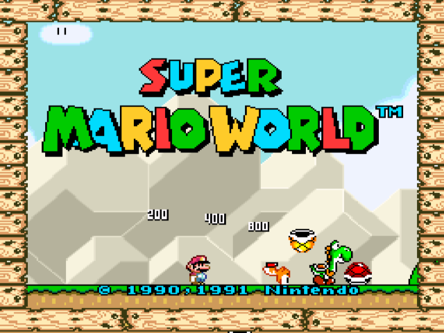

# SNES Emulator for the Midway Seattle Board

**Snes9x 1.39 on the Midway A-21464 arcade board: QED R5000 at 150 MHz, 8 MB DRAM, 3Dfx Voodoo SST-1, DCS2 ADSP-2115 sound. 65C816 loop, SPC700 loop, tile renderers and line fills in R5000 assembler; frame of 8-bit palette indices coloured and scaled by the Voodoo texture unit. Super Mario World: 60.0 emulated and 59.8 shown frames a second on the board, sound at 31,250 Hz stereo.**

<b>Figure 1.</b> Super Mario World (USA), attract demo, frame of 8-bit palette indices displayed through the TMU palette. MAME 0.289 driver blitz99, snapshot of the emulated Voodoo output in the 512 x 240 mode, shown at the 4:3 proportion of the monitor. The program has no screen capture path on the board; the picture on the board was confirmed correct by the owner at the cabinet.

---

## 1 Features

| System | Video and sound |
|---|---|
| Snes9x 1.39 core: 65C816, SPC700, S-DSP, PPU modes 0 to 7, HDMA, colour math | Frame 256 x 224 or 239, drawn as RGB565 or as 8-bit palette indices |
| 65C816 loop `cpu65.S` (2,306 lines), SPC700 loop `spc700.S` (1,452 lines) | Texture formats RGB565 and P8, written by GT-64010 DMA channel 0 |
| Tile renderers `tile16.S` (RGB565) and `tile8.S` (palette indices), whole runs of background tiles per call | One textured quad a frame; point or bilinear filter; fill, integer or 1:1 scaling |
| Every assembler path selectable against the C path at run time | Video modes 512 x 240 (59.98 Hz, default), 512 x 256 (54 Hz), 384 x 240, 512 x 384 |
| Automatic frame skip with a lateness tolerance | 31,250 Hz stereo 16-bit to the DCS2 FIFO |
| Game list from `/snes` on exFAT, battery RAM in `/saves` | JAMMA controls mapped to one or two SNES pads |
| CRC-32 lines of machine state, rendered frames, displayed buffer and mixed sound for verification | 1 kHz program-counter profile, 128-byte and 8-byte buckets |

## 2 General Description

The emulator is the Snes9x 1.39 release source with a platform layer for the Midway Seattle board and a set of changes to the core. It is built into the disk build of the board's bring-up monitor (project Blitz99, repository seattle-quake2) and started from the launch menu of the boot ROM. Games are read from an exFAT volume on the CompactFlash card.

The core in C renders 10 frames a second on the 150 MHz R5000, which has 32 KB primary caches and no second-level cache. The assembler loops, the changed drawing path and the paletted texture bring the rendered frame from 36.4 ms to 12.6 ms; the frame time of the console is 16.64 ms.

## 3 Basis of the Port

| Item | Value |
|---|---|
| Upstream project | Snes9x 1.39 release source `s9xs139.zip`, <https://www.lysator.liu.se/snes9x/1.39/s9xs139.zip>, 666,463 bytes |
| Upstream SHA-256 | `996b3ed10debca64e02e31f28e3e7f78b3d39608aa918cb739b2c2fa17bce27b` |
| Authors | Gary Henderson, Jerremy Koot; Super FX, DSP-1 and C4 code by the contributors named in `copyright.h` |
| Licence | Snes9x licence: use, copy, modify and distribute for non-commercial purposes (`docs/SNES.md` section 1.1 quotes it) |
| Untouched upstream copy | not in this repository; the archive above |
| Core changes | `patches/snes9x-1.39-seattle.patch`; applied to the unpacked archive it reproduces the build tree |
| Platform layer and assembler | `snes/`, by Mike Wolak, EPROM Foundry Inc., project Blitz99; the opcode semantics of `cpu65.S` and `spc700.S` are those of the Snes9x 1.39 sources (work derived from Snes9x, Snes9x licence) |
| Host tree | bring-up monitor, repository seattle-quake2, branch `bringup-rom`, commit `d3f8657`; `snes/` is its `bringup/snes/` |
| Palette download | register sequence of `_grTexDownloadPalette`, Glide 2.x, 3Dfx Interactive |
| File system | FatFs R0.16, ChaN (in the host tree) |
| Change record | `docs/SNES.md` sections 3, 9, 10 and 11 |

No game image, no Midway software and no Snes9x source file is in this repository.

### 3.1 Modifications to the Core

| Area | Change | Reason |
|---|---|---|
| `tile.cpp` `DrawTile16`, `DrawClippedTile16` | colour table and depths in locals; four depth bytes compared in one word; a group of four pixels skipped or written whole | the byte stores to the depth buffer made the compiler reload the values for every pixel |
| `tile.cpp` `ConvertTile` | result 3 for a tile with no pixel of value 0 | the row loops for such tiles omit the zero test |
| `gfx.cpp` `S9xUpdateScreen` | lines rendered in strips of 16; backdrop passes by depth words; sub screen drawn into the main screen for backdrop-only addition | a strip of the screen and depth buffers stays in the 32 KB data cache; each pixel is written once |
| `gfx.cpp` `DrawBackground` | runs of unclipped 8 x 8 tiles passed to `s9x_tilerun16` or `s9x_tilerun8` | 2,100 of 4,000 tile calls a frame are for blank tiles; the per-tile set-up is read once per run |
| `gfx.cpp` `S9xUpdateScreenLines` | frame of 8-bit palette indices for BG modes 0 and 1 without per-pixel colour math; expansion to RGB565 on a change of the colours within a frame | a group of four pixels becomes one word store; the texture is half the size |
| `soundux.cpp` `MixStereo` | envelope error, rate and sample counter in locals | read and written once per channel instead of once per sample |
| `memmap.h`, `memmap.cpp` | image buffer size from the build (`S9X_MAX_ROM_SIZE`); C4 RAM placed below the scratch area at the top of a buffer under 0x412000 bytes | 8 MB of DRAM hold the disk build, 2.3 MB of core tables and at most a 2.5 MB image buffer |
| `dsp1.h` | declaration of `DSP1` moved inside the `extern "C"` block | GCC 12 rejects the declaration with C++ linkage that precedes the definition |

## 4 Repository Contents

| Path | Content |
|---|---|
| `snes/s9x_seattle.c` | platform layer: memory arena, settings, video (texture, palette, DMA, quad), sound FIFO, pads, frame pacing, reports |
| `snes/s9x_cpu.cpp`, `snes/s9x_offs.cpp`, `snes/s9x_port.h` | interface of the assembler loops to the core; structure offsets; port definitions |
| `snes/menu.c` | game list |
| `snes/cpu65.S`, `snes/spc700.S` | 65C816 and SPC700 instruction loops |
| `snes/tile16.S`, `snes/tile8.S` | tile renderers for RGB565 and for palette indices |
| `snes/draw.S`, `snes/blit.S` | line fills by cache-line allocation; 1:1 frame copy to the linear frame buffer |
| `patches/snes9x-1.39-seattle.patch` | changes to the core |
| `patches/bringup-snes-integration.patch` | Makefile and launch-menu integration for a host tree without the SNES block |
| `docs/SNES.md` | technical record: provenance, settings, tests, measurements of every step |
| `docs/datasheet/SEATTLE_SNES.pdf` | data sheet SNES-A21464 Rev. 1, with annotated listings of the assembler paths (`.md` source and `.html` beside it) |
| `tools/snesiter.sh` | one measurement run on the board from the host that holds the serial line |

## 5 Assembler Routines and Their Effect

Board, Super Mario World attract demo, sound on, automatic frame skip. A rendered frame is emulation plus drawing; a skipped frame is emulation alone. Each row adds its step to the rows above.

| Step | Rendered frame | Skipped frame | Shown frames/s |
|---|---|---|---|
| Unmodified core, C loops | 36.4 ms | 9.5 ms | 10.2 |
| 65C816 loop `cpu65.S` | 33.6 ms | 6.4 ms | 16.4 |
| SPC700 loop `spc700.S`, run in batches against recorded cycle limits | 32.9 ms | 5.7 ms | 17.9 |
| Drawing path of section 3.1 in C, line fills `draw.S` | 16.9 ms | 5.6 ms | 36.5 |
| Frame texture by GT-64010 DMA | 17.4 ms | 5.9 ms | 39.3 |
| `tile16.S`, `tile8.S`, P8 texture, 512 x 240 mode | 12.6 ms | 6.3 ms | 54.7 |
| Frame skip with lateness tolerance | 12.6 ms | 5.8 ms | 59.8 |

The parts of the sixth row, measured in MAME (times follow the instruction count): C tile renderer 12,768 us; `s9x_tile16` and `s9x_ctile16` 11,652 us; with tile runs 10,553 us; with delay slots and sign tests 10,251 us; with the frame of palette indices 8,724 us.

A group of four pixels written whole costs 28 instructions in `tile16.S` (four table lookups, four halfword stores, one depth word) and 11 in `tile8.S` (one addition, one screen word, one depth word). The data sheet lists the code of each path with a comment on every step.

## 6 Build and Installation

1. Unpack `s9xs139.zip` into `$HOME/snes9x-1.39` and apply `patches/snes9x-1.39-seattle.patch` with `patch -p1`.
2. Place `snes/` as `bringup/snes/` in the bring-up tree of repository seattle-quake2 at commit `d3f8657` or later. A tree without the SNES block takes `patches/bringup-snes-integration.patch`.
3. Build the disk build: `make -C bringup FATFS=1 BUILD=build-fs EXTRA="-DUART_DIV=0x00u" build-fs/payload.bin`. Toolchain: `mipsel-none-elf` GCC 12.2.0 with newlib.
4. Write the payload with its header sector to the card at LBA 0x3EE080 (monitor command `dsave`, or `disk write` of the remote protocol client).
5. Copy game images (`.smc`, `.sfc`, `.swc`, `.fig`) to `/snes` on the exFAT volume of the card.
6. Start the program from the launch menu of the boot ROM: Other Apps, SNES.

Release build of this revision: payload 1,358,916 bytes, CRC32 6f5d6ab9; card image with header 1,359,872 bytes, CRC32 823a2781.

## 7 Verification

| Test | Result |
|---|---|
| MAME 0.289 driver blitz99, 120 s, each step of the tile work against the C renderer | 98 frame CRC lines (2,940 rendered frames) and 98 state CRC lines equal |
| MAME, 70 s, displayed Voodoo buffer, palette indices against RGB565 | 67 CRC lines equal |
| MAME, 60 s, every frame changed over to RGB565 at line 112 | 38 frame and 38 state CRC lines equal to the reference |
| Board, 40 s, release build against the MAME run of the C renderer | 38 frame CRC lines (1,140 rendered frames) and 38 state CRC lines equal |
| Board, 65C816 and SPC700 loops against the C loops | 10 state CRC lines equal, and equal to MAME |
| Board, picture and sound at the cabinet | correct (owner) |

## 8 Limits and Untested Items

| Item | State |
|---|---|
| Games other than Super Mario World (USA) | untested |
| Super FX, SA-1, DSP-1, C4, S-DD1, HiROM images, PAL timing | untested |
| Frame of palette indices in BG mode 0, with 16 x 16 tiles, with colour windows | untested |
| BG modes 2 to 7, mosaic, colour math on a layer | drawn as RGB565 by the C renderer; speed not measured |
| Memory | 19 KB of the arena free at game start; a second game start without a reset failed once to allocate, cause not established |
| Build outside the host tree | not provided: the platform layer uses the Voodoo, interrupt, sound, file-system and monitor code of the bring-up tree |
